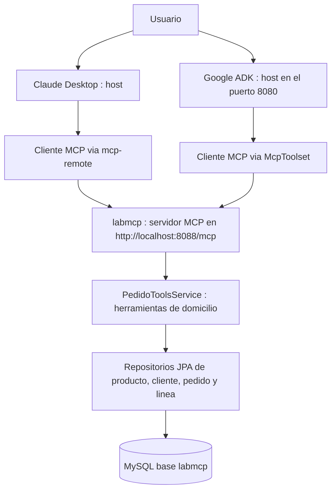

# Diagrama de arquitectura

Roles de este laboratorio: el host contiene al cliente MCP, el servidor es `labmcp` y la herramienta es cada método de `PedidoToolsService`.

El mismo servidor atiende a los dos hosts. Claude y ADK no se hablan entre sí. El catálogo, el stock y el estado del domicilio viven en MySQL.
